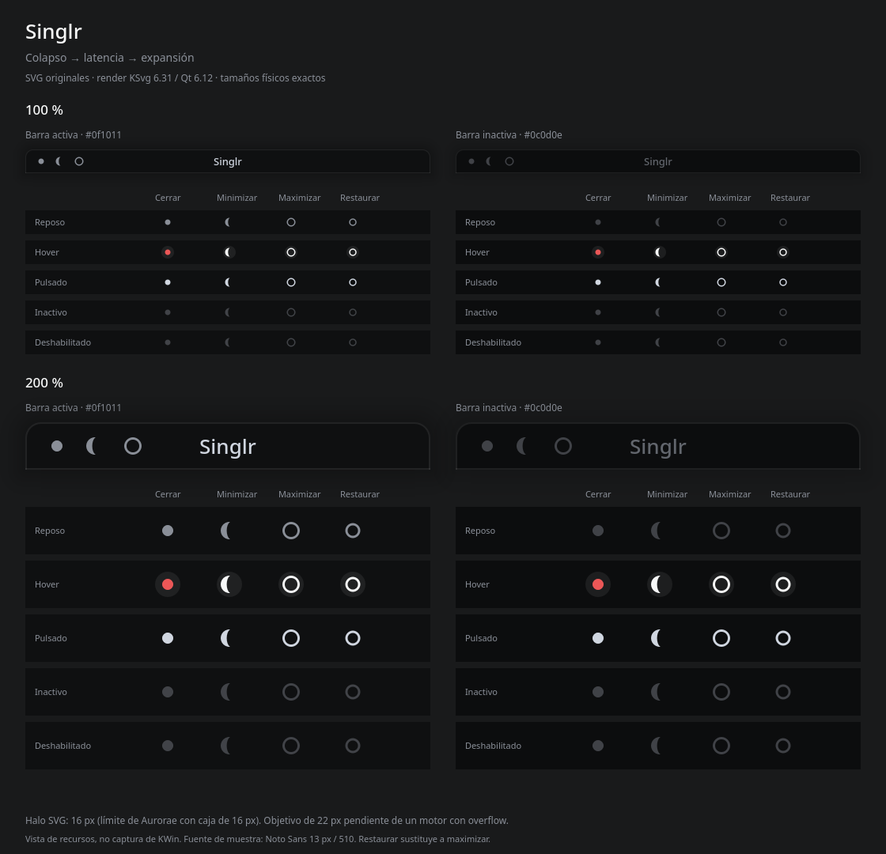

# Singlr — decoración Aurorae (T221)

Tema SVG original para Plasma/KWin 6. Prototipo revisable, sin instalar ni activar.
La referencia WhiteSur local se consultó únicamente para estructura y nombres de
archivo; no se reutilizó su arte. No hay cambios en `shell/qml/`.



## Diseño y límites del motor

Decisión explícita del creador en T221: cerrar como colapso (disco), minimizar como
latencia (creciente) y maximizar como expansión (anillo). Restaurar usa un anillo
menor. Superficies, colores y medidas proceden del mismo encargo; no se elevan a
tokens aprobados para otras partes del escritorio.

Ajuste óptico propuesto: rejilla de 16 px, disco de 7 px, creciente de 11 px de
diámetro exterior y anillo de 11 px con trazo de 1,5 px. Restaurar tiene diámetro
exterior de 9,5 px y el mismo trazo. El creciente se engrosó tras la primera
renderización comparada. La cobertura alfa rasterizada a 100 % es 37,5 / 34,7 /
43,0 / 35,4 px² respectivamente: una referencia de masa, no una prueba de igualdad
perceptual. Se revisaron juntos a 100 % y 200 %; queda la valoración del creador.

`Singlrrc` conserva botones de 16 × 16 px con 8 px entre cajas y una barra de
30 px: `7 + max(16, 16 + 0) + 7`. El marco tiene borde blanco al 20/255,
esquinas superiores de 10 px, inferiores rectas y sombra vectorial suave de
24 px, más tenue en ventanas inactivas. Se evita el filtro SVG de desenfoque para
mantener el renderizado con QtSvg. Maximizada usa superficie rectangular sin
sombra exterior ni esquinas redondeadas.

Hay tres límites relevantes de Aurorae SVG:

- **Halo:** `FrameSvgItem` pinta dentro de la caja del botón. Con cajas de 16 px,
  un círculo de 22 px se reduce o se recorta; no puede desbordar conservando el
  glifo. Esta entrega usa un halo circular de **16 px**, blanco al 18/255. Es una
  desviación técnica explícita respecto de los 22 px pedidos. Para alcanzar
  exactamente 22 px se necesita ampliar la caja (y revisar el espaciado) o usar
  una decoración QML/C++; no se modifica el motor en este encargo.
- **Fuente:** Aurorae obtiene `options.titleFont` de KWin. No existen claves
  funcionales de fuente/tamaño/peso en el rc del tema. El objetivo es **13 px,
  peso 510**, sin sombra; `UseTextShadow=false` y alineación centrada sí se
  configuran aquí. La preview usa Noto Sans, disponible localmente, a ese tamaño
  y peso solicitado; la familia instalada puede aproximar el peso. La fuente
  efectiva de una instalación dependerá de las preferencias globales.
- **Botones a la izquierda:** el orden viene de KWin, no de `LeftButtons` en el
  rc de Aurorae. Se documenta abajo `ButtonsOnLeft=XIA` y derecha vacía. Los
  márgenes del título compensan ese grupo de 64 px para centrarlo en la ventana;
  otros órdenes necesitan otra compensación. Restaurar sustituye a maximizar,
  no aparece como un cuarto botón simultáneo.

Los cuatro SVG incluyen `active-center`, `hover-center`, `pressed-center`,
`inactive-center`, `deactivated-center` y variantes `hover-inactive`,
`pressed-inactive`, `deactivated-inactive`. Inactivo/deshabilitado usa
`#62666d` al 60 %. Hover solo vuelve rojo suave el disco de cerrar. No hay
cruces, guiones ni marcas de maximizar tradicionales. Los símbolos y cajas
pequeños requieren comprobar reconocimiento e interacción en una sesión aislada.

## Instalación manual futura

Estas instrucciones **no se han ejecutado**. Desde la raíz del repositorio:

```bash
mkdir -p ~/.local/share/aurorae/themes/Singlr
cp decoration/aurorae/Singlr/{metadata.desktop,metadata.json,Singlrrc,decoration.svg,close.svg,minimize.svg,maximize.svg,restore.svg} ~/.local/share/aurorae/themes/Singlr/
```

Seleccionar **Singlr** en Preferencias del sistema → Decoraciones de ventanas.
La configuración correspondiente de `~/.config/kwinrc` es:

```ini
[org.kde.kdecoration2]
library=org.kde.kwin.aurorae
theme=__aurorae__svg__Singlr
ButtonsOnLeft=XIA
ButtonsOnRight=
```

`X` = cerrar, `I` = minimizar, `A` = maximizar/restaurar. En la configuración del
tema, mantener tamaño de botones **Normal**; el tamaño de borde de KWin puede
sobrescribir los márgenes de 1 px (usar **Diminuto/Tiny** para conservarlos).
Ajustar la fuente del título en Preferencias del sistema → Tipos de letra:
13 px equivalen a 9,75 pt a 96 DPI; el peso exacto 510 requiere una familia y
configuración que lo admitan. El rc del tema no puede imponerlo.

Antes de activar, conservar el tema, orden, fuente y tamaño de borde anteriores.
Para revertir, seleccionarlos otra vez y retirar únicamente la carpeta `Singlr`
instalada. No hace falta reiniciar KWin a mano. Las aplicaciones con decoración
propia (CSD) no adoptan necesariamente Aurorae.

## Evidencia y reproducción

Entorno inspeccionado: KWin 6.8.1-2, Qt Base/Svg 6.12.0 y KSvg 6.31.0.
La preview usa **KSvg::FrameSvg** para los SVG entregados, a factores de píxel
1 y 2. Las filas muestran reposo, hover, pulsado, inactivo y deshabilitado sobre
ambas superficies. La cabecera de cada panel muestra los tres botones reales.
Es una composición de recursos renderizados, no una captura de KWin ejecutando
el tema ni una prueba de sus zonas interactivas.

Con los paquetes de desarrollo ya disponibles, desde la raíz del repositorio:

```bash
g++ -std=c++17 -fPIC decoration/aurorae/Singlr/render-preview.cpp \
  -o /tmp/singlr-decoration-preview \
  $(pkg-config --cflags --libs Qt6Gui Qt6Svg) \
  -I/usr/include/KF6/KSvg -lKF6Svg
QT_QPA_PLATFORM=offscreen XDG_CACHE_HOME=/tmp/singlr-decoration-cache \
  /tmp/singlr-decoration-preview "$PWD/decoration/aurorae/Singlr"
```

Comprobado: compilación del visor, renderizado de todos los estados, revisión
visual del PNG, XML/JSON válidos e identificadores de nueve piezas del marco.
Se corrigieron uniones de esquinas detectadas al renderizar; las piezas tienen
márgenes congruentes de 34 px (24 de sombra + 10 de esquina).
`python3 scripts/check_setup.py` comprueba la preparación del repositorio, no el
tema en KWin. Pendiente: carga real, maximizar/restaurar, hover/clic, escalado de
pantalla y compatibilidad por aplicación en una sesión anidada autorizada.
No se instalaron paquetes, no se tocó la sesión ni se creó un commit.

Contrato contrastado con la [documentación oficial de Aurorae](https://develop.kde.org/docs/plasma/aurorae/),
[ThemeConfig](https://invent.kde.org/plasma/aurorae/-/blob/master/v1/lib/themeconfig.cpp)
y los archivos instalados de KWin 6.8.1 en `/usr/share/kwin/aurorae/`
(`AuroraeButton.qml`, `AuroraeButtonGroup.qml`, `aurorae.qml`). El código local
es la referencia para el comportamiento comprobado; las fuentes web pueden
evolucionar. La documentación general incluye apartados heredados.
